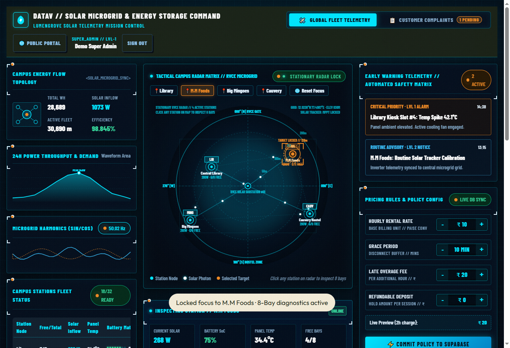
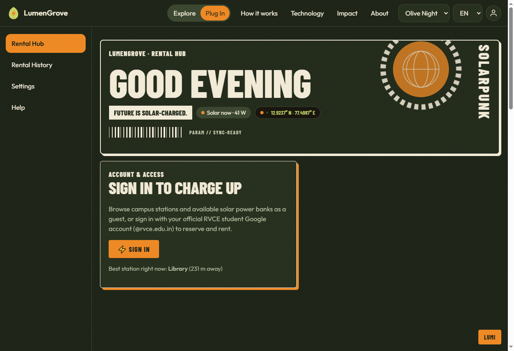
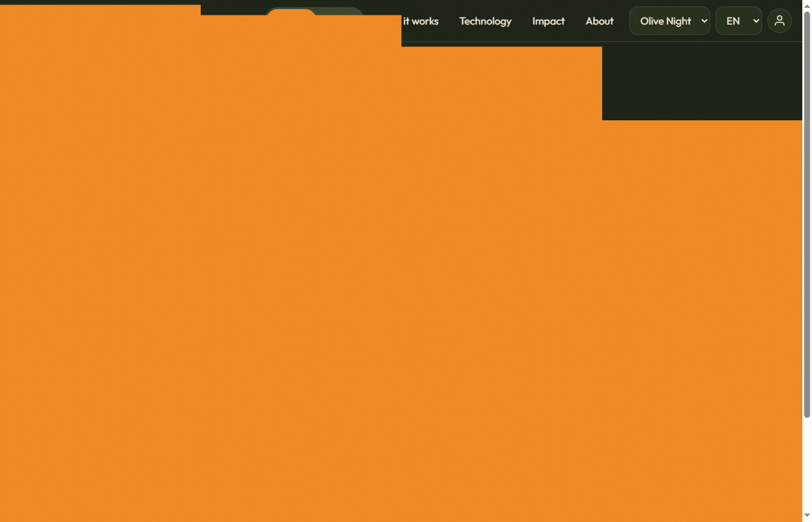
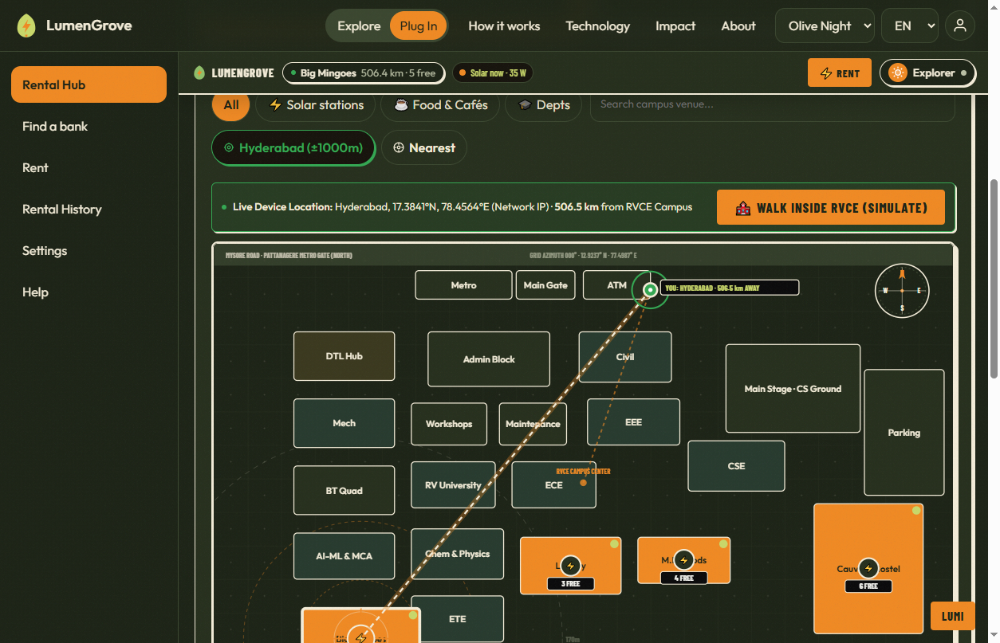
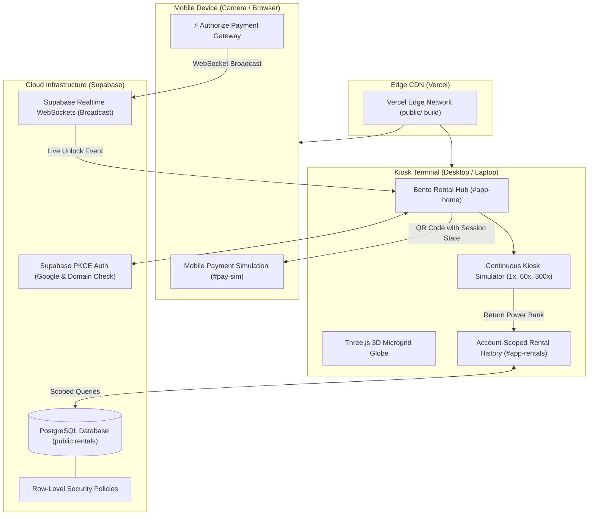

# ☀️ LumenGrove · Solar-Powered Campus Power Bank Network

> **Autonomous Solar-Charged Power Bank Rental System & Aerospace Telemetry Command Center (v2.2)**  
> Engineered and optimized for the R.V. College of Engineering (RVCE) Campus.

[](https://vercel.com)
[](https://supabase.com)
[](https://threejs.org)
[](https://developer.mozilla.org)
[](DEMO_CHEAT_SHEET.md)

---

## 📌 Executive Overview

**LumenGrove** is a sustainable IoT microgrid and smart hardware rental platform providing RVCE students and faculty with 100% solar-charged portable power banks. The platform seamlessly bridges consumer-facing hardware checkout with industrial-grade aerospace telemetry and microgrid management.

### System Highlights:
1. **Public Student Bento Portal (`#app-home`)**: Seamless kiosk discovery, real-time GPS geolocation (Haversine formula), solar power bank rental with guest lockout protection, and custom solarpunk profile cards.
2. **Cross-Device Mobile Payment Simulation Gateway (`#pay-sim`)**: Dynamic QR code checkout that synchronizes station configurations across laptop and mobile phones, unlocking kiosk slots in real time via **Supabase Realtime WebSockets**.
3. **Continuous Time-Dilation Kiosk Simulator**: Interactive hardware simulator with 8-bay solenoid ejection, live battery SoC/voltage telemetry, and continuous elapsed time accumulation across $1\times$, $60\times$, and $300\times$ speeds.
4. **Account-Scoped Relational Rental History (`#app-rentals`)**: Full database lifecycle management in `public.rentals` (Paid $\rightarrow$ Active $\rightarrow$ Completed), persistent across sign-outs with strict student account isolation.
5. **10k Cyber Aerospace Mission Control (`#admin`)**: An isolated, full-bleed telemetry HUD featuring stationary RVCE vector radar, click-to-select station targeting, 8-bay hardware diagnostics, and an integrated **Customer Complaints Hub**.

> 💡 **For Viva Evaluators:** Refer to [DEMO_CHEAT_SHEET.md](DEMO_CHEAT_SHEET.md) for a timed 3-minute presentation script and technical defense answers.

---

## 📸 Visual Showcase & UI Gallery

### 1. Stationary Campus Microgrid Radar Map & Mission Control (`#admin`)
*Isolated 10k Mission Control with stationary RVCE vector radar, click-to-select station targeting, and 8-bay hardware diagnostics.*

| Stationary RVCE Campus Microgrid Radar Map | Cyber Pricing Deck & Segmented Battery Matrix |
|:---:|:---:|
|  |  |

### 2. Clean Student Bento Rental Hub (`#app-home`) & Complaints Hub
| Clean Sign-In Experience (`#app-home`) | Customer Complaints Resolution Hub |
|:---:|:---:|
|  |  |

### 3. Student Bento Rental Hub & Guest Lockout Overlay
| Unlocked Student Portal | Guest Lockout Protection Overlay |
|:---:|:---:|
|  |  |

### 4. Interactive Campus GPS Navigation & Mobile Telemetry
| RVCE Campus Radar & Device Geolocation | Mobile Telemetry Viewport |
|:---:|:---:|
|  |  |

---

## 🎯 Key Capabilities & Features

### 1. 🎓 Student Experience & Bento Rental Hub
- **Real-Time Geolocation**: High-accuracy GPS tracking with automatic IP geolocation fallback and dynamic Haversine distance computation to nearest campus kiosks.
- **Guest Lockout Protection**: Unauthenticated visitors can freely browse campus station inventory and pricing; rental duration controls and checkout are secured behind an interactive sign-in modal.
- **Verified Student Profiles**: Authentication supporting verified student email domains (`@rvce.edu.in`) and persistent verified Indian phone numbers (`+91`).
- **Solarpunk Customization**: In-app avatar personalization (Helios, Sol, Nova, Terra) and bilingual accessibility (English, Kannada, Hindi).

### 2. 💳 Cross-Device Mobile QR Simulation Gateway (`#pay-sim`)
- **Seamless Laptop-to-Phone Sync**: Generating a pass embeds the chosen station, battery type, duration, and calculated rate into the QR payload.
- **Dual Query String Parsing**: Supports both hash-fragment (`#pay-sim?...`) and standard query parameters (`?...#pay-sim`) across all iOS and Android camera apps.
- **Realtime Broadcast Synchronization**: Authorizing payment on a smartphone transmits WebSocket broadcasts (`lg_pay_${sessionId}`) across the internet to the laptop kiosk without requiring database table writes or RLS permissions.
- **Viva Speed Simulation**: Manual `[⚡ Simulate Bank Webhook Approval]` button available directly on the kiosk card for rapid academic demonstration.

### 3. ⏱️ Continuous Time-Dilation Kiosk Simulator
- **Station Hardware Simulator**: Enter the issued 6-digit PIN on the digitizer to trigger simulated physical solenoid ejection on bays 1 through 8.
- **Continuous Time-Dilation Architecture**: Mathematically re-anchors session timestamps whenever toggling between $1\times$ (Realtime), $60\times$ (1s = 1m), and $300\times$ (Fast Test) multipliers, completely preventing timer jumps or resets.
- **Dynamic Cost Engine**: Real-time calculation of active duration, grace window ($15\text{ min}$), overdue penalties, and final billing.
- **Live Battery Telemetry**: Real-time discharge rate simulation, state-of-charge ($\text{SoC}$), cell voltage ($3.60\text{V} - 4.18\text{V}$), core temperature, and closest return hub routing.

### 4. 📊 Account-Scoped Relational Rental History (`public.rentals`)
- **Database-Driven Records**: Dynamically queries Supabase `public.rentals` (`user_id = auth.uid()`) to display authentic historical charging transactions.
- **Full Rental DB Lifecycle**: Automatically configures and inserts rental records into `public.rentals` upon payment authorization (`status: 'paid'`), transitions to `'active'` upon kiosk PIN unlock, and finalizes to `'completed'` with exact duration and paise amount upon hardware return.
- **Sign-Out History Persistence**: Signing out preserves previous transactions on-screen and in local cache, allowing users to inspect past receipts while showing a clean prompt to sign in for new rentals.
- **Strict Account Isolation**: Rental records are strictly isolated per student account; logging out or switching profiles displays strictly that student's own verified history without cross-account data leaks.

### 5. 🛰️ Mission Control Telemetry Dashboard (`#admin`)
- **Complete Theme Isolation**: High-tech cyber aerospace design (`.admin-telemetry-mode`) that isolates staff operations and provides a one-click `[🌐 Public Portal]` return button.
- **Campus Energy Flow Topology Radar**: Real-time vector radar monitoring solar inverter inputs, microgrid harmonic balance ($50.02\text{ Hz}$), and active fleet throughput.
- **Stationary RVCE Vector Radar Map**:
  - 2D tactical vector radar locked onto the 4 campus solar stations.
  - Interactive click-to-select targeting: click any station to lock target reticles, display live **Station Inspection HUDs**, and synchronize the **8-Bay Hardware Diagnostics Matrix**.
  - Concentric polar range rings ($50\text{m}, 100\text{m}, 150\text{m}, 200\text{m}$) and cardinal azimuth headings ($000^\circ\text{ N}, 090^\circ\text{ E}, 180^\circ\text{ S}, 270^\circ\text{ W}$).
- **Cyber Fleet Status & Stepper Pricing Terminal**:
  - Segmented LED fuel/battery matrix gauges replacing generic bars.
  - High-tech digital stepper controls (`[-]` / `[+]`) for hourly rates, grace periods, and late fees.
  - Two-way Supabase database synchronization (`[⚡ COMMIT POLICY TO SUPABASE]`).

### 6. 📋 Customer Complaints Hub
- Real-time ticket feed with live KPI metrics (Open, In Progress, Resolved, and Resolution Rate).
- Instant multi-parameter search (by student name, ticket ID, phone number) and status filter pills.
- Verified student contact details with registered `+91` numbers.
- One-click staff resolution: `[🛠️ Dispatch Field Technician]` and `[✓ Mark as Resolved]`.

---

## 🗺️ Campus Kiosk Stations (RVCE)

| Station ID | Location | Coordinates | Total Bays | Solar Capacity | Status |
|---|---|---|---|---|---|
| `library` | Central Library | $12.9238^\circ\text{N}, 77.4987^\circ\text{E}$ | 8 Slots | $180\text{ W}$ Bifacial PV | 🟢 Operational |
| `mm` | M.M Foods Plaza | $12.9245^\circ\text{N}, 77.4992^\circ\text{E}$ | 8 Slots | $220\text{ W}$ Monocrystalline | 🟢 Operational |
| `mingoes` | Big Mingoes | $12.9231^\circ\text{N}, 77.4979^\circ\text{E}$ | 8 Slots | $160\text{ W}$ Off-Grid Array | 🟢 Operational |
| `cauvery` | Cauvery Canteen | $12.9250^\circ\text{N}, 77.5001^\circ\text{E}$ | 8 Slots | $200\text{ W}$ Canopy Array | 🟢 Operational |

---

## 🏗️ System Architecture & Tech Stack



- **Frontend**: Vanilla ES6+, CSS Grid/Flexbox Bento Design, Three.js (r128), QRCode.js.
- **Backend / Database**: Supabase (PostgreSQL 15, Row-Level Security, Realtime WebSocket Broadcast).
- **Geolocation Engine**: HTML5 Geolocation API, Haversine Great-Circle Navigation, IP fallback.
- **Production Host**: Vercel SPA (`outputDirectory: "public"`).

---

## 📊 Academic Evaluation Rubric Alignment

| Evaluation Criteria | Implementation in LumenGrove |
|---|---|
| **System Architecture & Design** | Decoupled client-side architecture with single-page curtain router, isolated aerospace telemetry module, and PostgreSQL relational schema with RLS. |
| **IoT & Telemetry Engineering** | Simulation of off-grid solar microgrid harmonics (50Hz), real-time MPPT power throughput, 8-bay solenoid latch telemetry, and Three.js 3D spatial visualization. |
| **Data Security & Integrity** | Strict domain verification (`@rvce.edu.in`), verified `+91` Indian mobile validation, guest lockout constraints, and PostgreSQL Row-Level Security policies. |
| **UI/UX & Mobile Responsiveness** | Solar-punk bento grid layout, bilingual accessibility (English, Kannada, Hindi), reduced motion preferences, and responsive breakpoint stacking for mobile viewports. |
| **Sustainability & Impact** | Zero-grid energy consumption model leveraging bifacial solar arrays and lithium iron phosphate ($\text{LiFePO}_4$) buffer storage to decarbonize campus charging. |

---

## ⚡ Quick Start & Local Setup

### Prerequisites
- Node.js (v18.0.0 or higher recommended)
- A modern web browser with WebGL support

### Installation
```bash
# Clone the repository
git clone https://github.com/mahanidhi604-star/LumenGrove.git
cd LumenGrove

# Install dependencies
npm install

# Build static assets to public/
npm run build

# Start local development server
npm start
```
The application will boot at `http://localhost:3000`.

---

## 🔑 Demo & Evaluator Testing Credentials

For viva examiners testing the live system, convenient one-click demo login profiles are provided on the login screens:

| Role | Access URL | Permissions & Features |
|---|---|---|
| **Student** | `#signin` $\rightarrow$ "Demo Student" | Rent power banks, view campus map, customize solarpunk profile, verify `+91` phone. |
| **Technician** | `#admin-login` $\rightarrow$ "Demo Technician" | 8-Bay Hardware Diagnostics Matrix, solenoid lock controls, view & resolve station complaints. |
| **Super Admin** | `#admin-login` $\rightarrow$ "Demo Super Admin" | Full DataV mission control, 3D Globe telemetry, Pricing Policy configuration, and Complaints Hub. |

---

## 👥 Project Team

- **Mahanidhi C** · RVCE26BCS040 · Computer Science & Engineering
- **Pragathi Medi** · RVCE26BAI104 · Artificial Intelligence & Machine Learning
- **B Jishnu** · RVCE26BEC009 · Electronics & Communication Engineering
- **Rohan Narendra** · RVCE26BAS045 · Aerospace Engineering

**Institution**: R.V. College of Engineering (RVCE), Bengaluru, Karnataka, India  
**Academic Year**: 2026 – 2027

---

## 📄 License
This project is developed for academic evaluation and research purposes under the MIT License.
