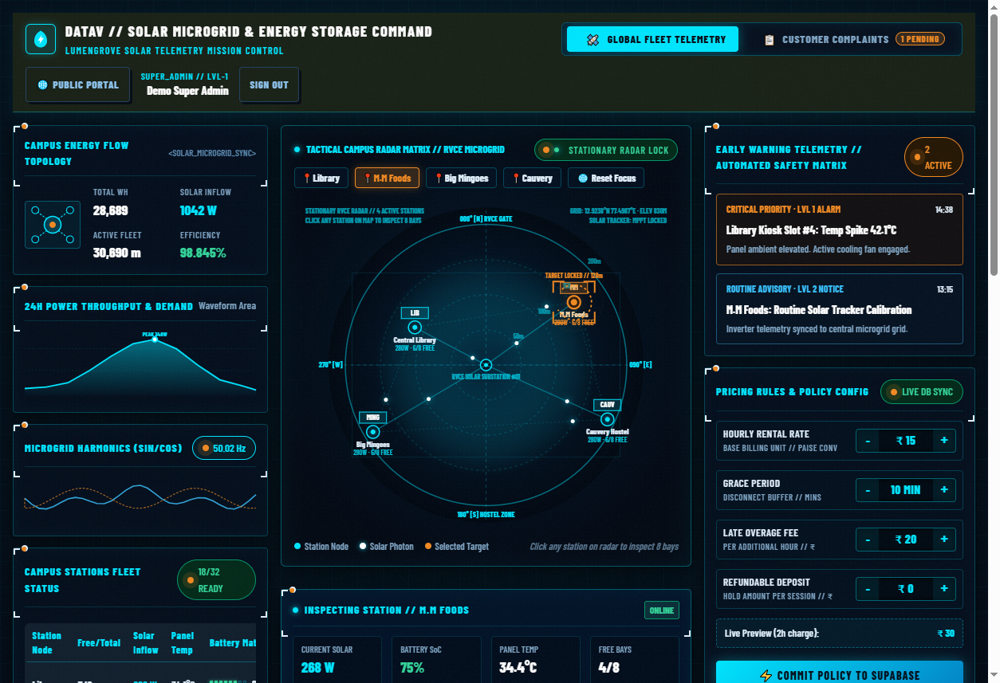
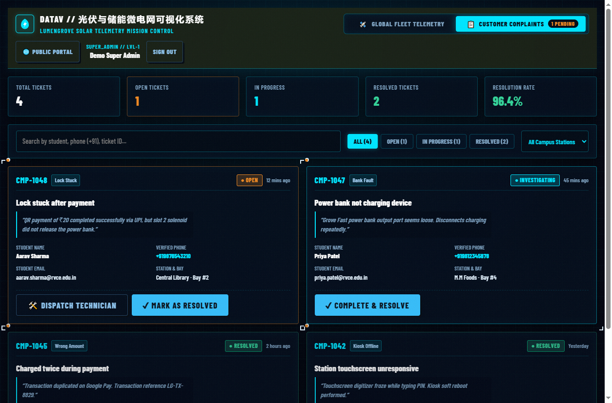
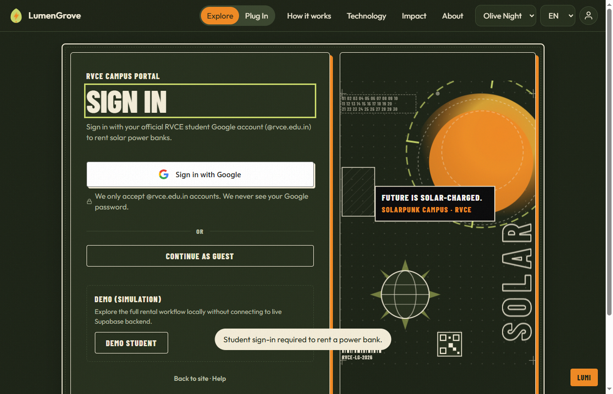
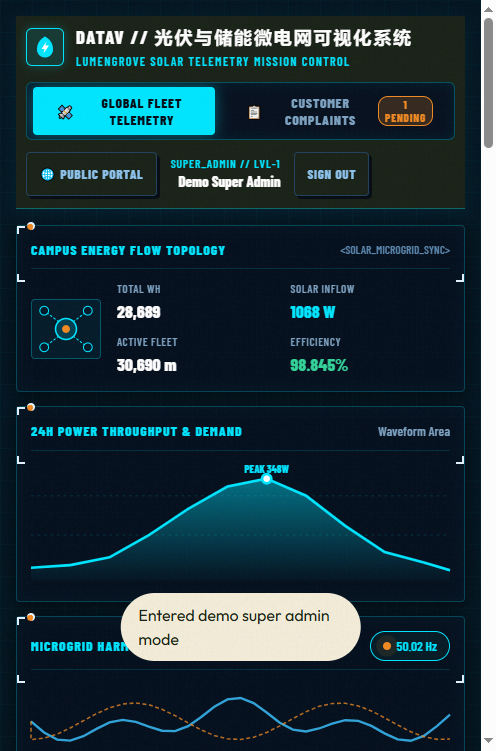
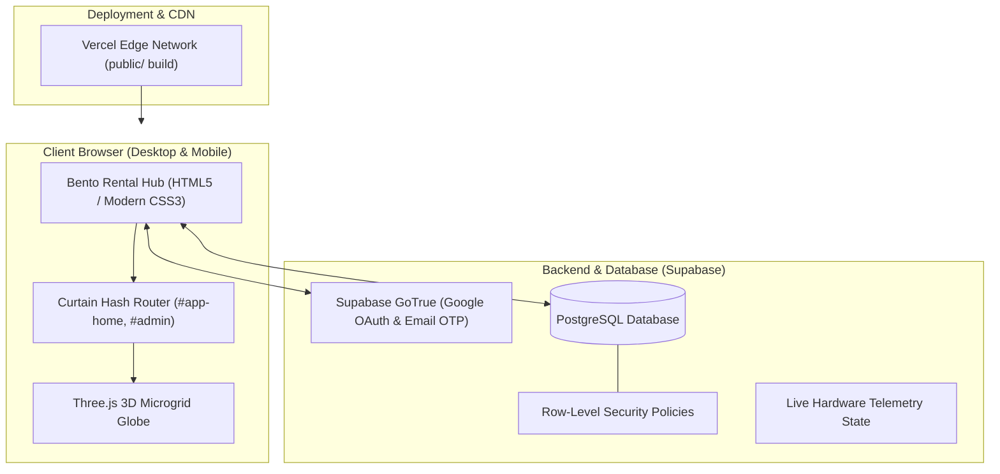

# ☀️ LumenGrove · Solar-Powered Campus Power Bank Network

> **Autonomous Solar-Charged Power Bank Rental System & Aerospace Telemetry Command Center**  
> Designed and optimized for the R.V. College of Engineering (RVCE) Campus.

[](https://vercel.com)
[](https://supabase.com)
[](https://threejs.org)
[](https://developer.mozilla.org)
[](DEMO_CHEAT_SHEET.md)

---

## 📌 Executive Overview

**LumenGrove** is a sustainable IoT microgrid and smart hardware rental platform that provides RVCE students and faculty with 100% solar-charged portable power banks. 

The platform integrates:
1. **Public Student Bento Portal**: Seamless kiosk discovery, real-time device geolocation (Haversine formula), solar power bank rental with guest lockout security, and custom student profile cards.
2. **10k Cyber Aerospace Mission Control (`DataV`)**: An isolated, full-bleed telemetry HUD featuring an interactive 3D spherical microgrid globe, real-time solar harvest calculations, hardware bay diagnostics, and an integrated **Customer Complaints Hub**.

> 💡 **For Evaluators & Viva Presentations:** Check out the complete [DEMO_CHEAT_SHEET.md](DEMO_CHEAT_SHEET.md) for the timed 3-minute presentation script and technical defense answers.

---

## 📸 Visual Showcase & UI Gallery

### 1. Stationary Campus Microgrid Radar Map & Mission Control (`#admin`)
*Isolated 10k Mission Control with stationary RVCE vector radar, click-to-select station targeting, and 8-bay hardware diagnostics.*

| Stationary RVCE Campus Microgrid Radar Map | Cyber Pricing Deck & Segmented Battery Matrix |
|:---:|:---:|
|  |  |

### 2. Clean Student Bento Rental Hub (`#app-home`) & Complaints Hub
| Clean Sign-In Experience (`#app-home`) | Customer Complaints Resolution Hub |
|:---:|:---:|
|  |  |

### 3. Student Bento Rental Hub & Guest Lockout Overlay
| Unlocked Student Portal | Guest Lockout Protection Overlay |
|:---:|:---:|
|  |  |

### 4. Interactive Campus GPS Navigation & Mobile Telemetry
| RVCE Campus Radar & Device Geolocation | Mobile Telemetry Viewport |
|:---:|:---:|
|  |  |
|  |  |

---

## 🎯 Key Capabilities & Features

### 1. 🎓 Student Experience & Bento Rental Hub
- **Real-Time Geolocation**: High-accuracy GPS tracking with automatic IP geolocation fallback and dynamic Haversine distance computation to nearest campus kiosks.
- **Guest Lock-On Protection**: Unauthenticated guests can freely explore campus stations and rates; duration slider and rental checkout are locked behind an interactive modal redirecting to verified sign-in.
- **Verified Student Profiles**: Authentication supporting verified student email domains (`@rvce.edu.in`) and persistent verified Indian phone numbers (`+91`).
- **Solarpunk Customization**: In-app avatar personalization (Helios, Sol, Nova, Terra) and bilingual accessibility (English, Kannada, Hindi).

### 2. 🛰️ Mission Control Telemetry Dashboard (`#admin`)
- **Complete Theme Isolation**: High-tech cyber aerospace design (`.admin-telemetry-mode`) that completely hides public navigation and offers a one-click `[🌐 Public Portal]` return button.
- **Campus Energy Flow Topology Radar**: Real-time vector radar monitoring solar inverter inputs, microgrid harmonic balance ($50.02\text{ Hz}$), and active fleet throughput.
- **Stationary RVCE Campus Microgrid Radar Map**:
  - 2D tactical vector radar locked directly onto the 4 campus solar stations.
  - Interactive click-to-select targeting: click any station on the map to lock target reticles, display live **Station Inspection HUDs**, and synchronize the **8-Bay Hardware Diagnostics Matrix**.
  - Concentric polar range rings ($50\text{m}, 100\text{m}, 150\text{m}, 200\text{m}$) and cardinal azimuth headings ($000^\circ\text{ N}, 090^\circ\text{ E}, 180^\circ\text{ S}, 270^\circ\text{ W}$).
  - Microgrid conduits with traveling solar photon animations connecting to central inverter substation.
- **Cyber Fleet Status & Stepper Pricing Terminal**:
  - Segmented LED fuel/battery matrix gauges replacing generic bars.
  - High-tech digital stepper controls (`[-]` / `[+]`) for hourly rates, grace periods, and late fees.
  - Direct two-way Supabase database synchronization (`[⚡ COMMIT POLICY TO SUPABASE]`).

### 3. 📋 Customer Complaints Hub (Sub-Page)
- Real-time ticket feed with live KPI metrics (Open, In Progress, Resolved, and Resolution Rate).
- Instant multi-parameter search (by student name, ticket ID, phone number) and status filter pills.
- Verified student contact details with registered `+91` numbers.
- One-click staff resolution: `[🛠️ Dispatch Field Technician]` and `[✓ Mark as Resolved]`.

---

## 🗺️ Campus Kiosk Stations (RVCE)

| Station ID | Location | Coordinates | Total Bays | Solar Capacity | Status |
|---|---|---|---|---|---|
| `library` | Central Library | $12.9238^\circ\text{N}, 77.4987^\circ\text{E}$ | 8 Slots | $180\text{ W}$ Bifacial PV | 🟢 Operational |
| `mm` | M.M Foods Plaza | $12.9245^\circ\text{N}, 77.4992^\circ\text{E}$ | 8 Slots | $220\text{ W}$ Monocrystalline | 🟢 Operational |
| `mingoes` | Big Mingoes | $12.9231^\circ\text{N}, 77.4979^\circ\text{E}$ | 8 Slots | $160\text{ W}$ Off-Grid Array | 🟢 Operational |
| `cauvery` | Cauvery Canteen | $12.9250^\circ\text{N}, 77.5001^\circ\text{E}$ | 8 Slots | $200\text{ W}$ Canopy Array | 🟢 Operational |

---

## 🏗️ System Architecture & Tech Stack



- **Frontend**: Vanilla ES6+, CSS Grid/Flexbox Bento Design, Three.js (r128).
- **Backend / DB**: Supabase (PostgreSQL 15, Row-Level Security, Realtime).
- **Geolocation**: HTML5 Geolocation API, Haversine Great-Circle Navigation, IP fallback.
- **Production Host**: Vercel SPA (`outputDirectory: "public"`).

---

## 📊 Academic Evaluation Rubric Alignment

| Evaluation Criteria | Implementation in LumenGrove |
|---|---|
| **System Architecture & Design** | Decoupled client-side architecture with single-page curtain router, isolated aerospace telemetry module, and PostgreSQL relational schema with RLS. |
| **IoT & Telemetry Engineering** | Simulation of off-grid solar microgrid harmonics (50Hz), real-time MPPT power throughput, 8-bay solenoid latch telemetry, and Three.js 3D spatial visualization. |
| **Data Security & Integrity** | Strict domain verification (`@rvce.edu.in`), verified `+91` Indian mobile validation, guest lockout constraints, and PostgreSQL Row-Level Security policies. |
| **UI/UX & Mobile Responsiveness** | Solar-punk bento grid layout, bilingual accessibility (English, Kannada, Hindi), reduced motion preferences, and responsive breakpoint stacking for mobile viewports. |
| **Sustainability & Impact** | Zero-grid energy consumption model leveraging bifacial solar arrays and lithium iron phosphate ($\text{LiFePO}_4$) buffer storage to decarbonize campus charging. |

---

## ⚡ Quick Start & Local Setup

### Prerequisites
- Node.js (v18.0.0 or higher recommended)
- A modern web browser with WebGL support

### Installation
```bash
# Clone the repository
git clone https://github.com/mahanidhi604-star/LumenGrove.git
cd LumenGrove

# Install dependencies
npm install

# Build static assets to public/
npm run build

# Start local development server
npm start
```
The server will boot at `http://localhost:3000`.

---

## 🔑 Demo & Evaluator Testing Credentials

For evaluators and examiners testing the application during vivas/presentations, convenient one-click demo login profiles are provided on the login screens:

| Role | Access URL | Permissions & Features |
|---|---|---|
| **Student** | `#signin` or click "Demo Student" | Rent power banks, view campus map, customize solarpunk profile, verify `+91` phone. |
| **Technician** | `#admin-login` $\rightarrow$ "Demo Technician" | 8-Bay Hardware Diagnostics Matrix, solenoid lock controls, view & resolve station complaints. |
| **Super Admin** | `#admin-login` $\rightarrow$ "Demo Super Admin" | Full DataV mission control, 3D Globe telemetry, Pricing Policy configuration, and Complaints Hub. |

---

## 👥 Project Team

- **Student Name 1**: [Your Name] · [USN] · [Department]
- **Student Name 2**: [Teammate Name] · [USN] · [Department]
- **Institution**: R.V. College of Engineering (RVCE), Bengaluru, Karnataka, India
- **Academic Year**: 2026 – 2027

---

## 📄 License
This project is developed for academic evaluation and research purposes under the MIT License.
